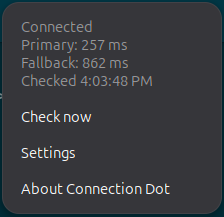

# Connection Dot

A prominent **20-pixel status dot** in the GNOME top bar that shows whether your internet connection is responsive, slow, or offline. Click it for response times, the most recent check, and settings.

**Internet status at a glance.**

Targets GNOME Shell **48, 49, and 50**. Local validation uses GNOME 50.1 on Ubuntu 26.04.1; GNOME 48 and 49 are not yet verified. Connection Dot is not currently listed on extensions.gnome.org.

## Screenshots

Connection details, cropped from the original screenshot without altering its content.



## What the colors mean

| Dot | Meaning |
| --- | --- |
| Green | Two consecutive successful, fast check cycles establish connectivity |
| Amber | Slow or interrupted checks; the menu also identifies sign-in-required captive portals |
| Red | No available network route, or repeated failed checks corroborated by limited system connectivity |
| Blue | Starting, checking, unable to verify internet access, or active checks disabled |

A cycle probes both endpoints concurrently. One expected response is enough to establish reachability, and the fastest successful response determines responsiveness. Two consecutive slow cycles produce amber. A fully failed cycle produces amber; three failures produce red only if the system also reports limited connectivity, otherwise blue. Network changes clear previous evidence.

The menu shows the status, primary and fallback results, and the last check time. **Check now** runs another cycle when idle. **Settings** opens preferences. **About** opens the configured project URL.

These measurements are **HTTP response time**, including connection and response work—not download speed, ICMP ping, or a packet-loss measurement. A green result cannot guarantee every website is reachable. A single failed provider does not prove your internet is offline.

## Requirements

### To run

- A GNOME Shell session with a supported major version; this is not a KDE, Cinnamon, or Xfce extension.
- GIO and libsoup 3; GTK4 and libadwaita for preferences.
- Your normal desktop session. Installation is per-user and does not require root.

### To build

- Node.js **24** and npm.
- Python **3**.
- `gnome-extensions` and `glib-compile-schemas`.

The installed extension runs JavaScript in GJS. Node.js and npm are only build tools.

On Ubuntu, the additional GNOME packages can be installed with:

```bash
sudo apt update
sudo apt install gnome-shell gjs libglib2.0-bin gir1.2-soup-3.0 gir1.2-gtk-4.0 gir1.2-adw-1 python3
```

## Install

When a stable release is available, download `connection-dot.shell-extension.zip` and its `.sha256` file from [GitHub Releases](https://github.com/derrick-nuby/connection-dot/releases). From the download directory:

```bash
sha256sum -c connection-dot.shell-extension.zip.sha256
gnome-extensions install --force connection-dot.shell-extension.zip
```

Save your work, **log out of GNOME and back in**, then enable it:

```bash
gnome-extensions enable connection-dot@derrick-nuby.github.io
gnome-extensions info connection-dot@derrick-nuby.github.io
```

Look for **State: ACTIVE** and the dot on the right of the top bar. Allow about 30–45 seconds for two successful checks to establish green; metered networks take longer. Open preferences from the dot's menu or run:

```bash
gnome-extensions prefs connection-dot@derrick-nuby.github.io
```

Installation is per-user. Do not run these commands with sudo. A GNOME Extensions installation link will be added after acceptance.

### Build from source

With the build requirements installed, run these commands in the repository:

```bash
npm ci
npm run check
npm test
npm run install:prod
```

Then log out/back in and enable the production UUID as above. `npm run pack` builds without installing. ZIPs and checksums are written to `artifacts/`.

## Preferences

| Setting | Default | Behavior |
| --- | --- | --- |
| Active checks | On | Enables HTTPS requests; turning it off hides response results and retains system connectivity status |
| Check interval | 30 seconds | Adjustable from 15–300 seconds; at least 120 seconds on metered connections |
| Request deadline | 5 seconds | Adjustable from 2–10 seconds; cancels an unfinished cycle |
| Slow response threshold | 1,500 ms | Adjustable from 250–4,500 ms; the effective threshold stays below the deadline |
| Primary HTTPS URL | `https://detectportal.firefox.com/success.txt` | Mozilla connectivity endpoint |
| Expected primary text | `success` | Must match the trimmed HTTP 200 response body |
| Fallback HTTPS URL | `https://fedoraproject.org/static/hotspot.txt` | Fedora connectivity endpoint |
| Expected fallback text | `OK` | Must match the trimmed HTTP 200 response body |

Changes apply automatically and restart measurement. **Reset defaults** restores all settings for the current build. Development and production have separate settings.

Custom endpoints must be HTTPS and must return HTTP 200 with the expected text. Redirects are not followed. Responses are limited to 4 KiB. Do not put passwords or access tokens in endpoint URLs. Both configured endpoints are checked each cycle; “fallback” does not mean it is contacted only when the primary fails.

## Privacy and keyboard behavior

The default checks contact Mozilla and Fedora. Those providers receive ordinary connection information such as your IP address. Custom endpoints receive the requests instead when configured. Turn off **Active checks** to stop these requests.

Connection Dot has no analytics, account system, persistent measurement history, cookie storage, clipboard access, global keyboard shortcuts, or keystroke recording. It uses asynchronous networking and honors the system's networking/proxy configuration rather than running shell commands to test connectivity.

The open panel menu uses GNOME's standard menu focus. Press **Escape** or click outside it to return input to your application. Preferences use normal text-entry controls. Keyboard trouble that persists with the menu closed is not expected; use the disable-and-compare check below rather than assuming its cause.

## Update, disable, remove, or roll back

Install the newer production ZIP using the installation commands above, then log out/back in to load the updated JavaScript. Ordinary upgrades preserve settings. Disable/enable alone may reuse cached code.

```bash
# Disable without removing settings:
gnome-extensions disable connection-dot@derrick-nuby.github.io
# Uninstall:
gnome-extensions uninstall connection-dot@derrick-nuby.github.io
```

To roll back, install an earlier trusted ZIP for the same UUID with `gnome-extensions install --force`, then log out/back in.

## Contributing: development builds

| Command | Purpose |
| --- | --- |
| `npm ci` | Install the committed dependency versions |
| `npm run check` | Strict TypeScript checking |
| `npm test` | Run classifier, controller/probe, and GLib URI tests |
| `npm run dev` | Watch TypeScript with source maps; no automatic installation |
| `npm run build:dev` | Build and verify the development ZIP |
| `npm run build` / `npm run pack` | Build and verify the production ZIP |
| `npm run verify:package` | Inspect production archive structure and generate its checksum |
| `npm run install:prod` | Build and install the production ZIP |
| `npm run install:dev` | Build and install the development ZIP |
| `npm run uninstall:dev` | Remove the development installation |

Production packages contain readable JavaScript, metadata, schema XML (compiled during installation), and the license. They exclude screenshots, tests, dependencies, and TypeScript source. Source maps are compiler output for development; the ZIP packer includes only its explicitly selected runtime files.

Development builds use the separate UUID `connection-dot-dev@derrick-nuby.github.io` and separate settings. Run `npm run install:dev`, log out/back in, then enable that UUID. Disable production while testing to avoid duplicate dots and network checks. `npm run dev` watches compilation only; it does not install or reload JavaScript.

Keep Shell widgets and GTK preferences in separate modules. Initialize live resources on enable, cancel requests and remove timers on disable, and finish asynchronous operations explicitly. Use `npm ci` in automation and commit dependency changes with the lockfile.

For isolated desktop testing, GNOME 48 uses a nested Wayland session; GNOME 49–50 use the development kit, which may need an extra distro package:

```bash
# GNOME 48:
dbus-run-session gnome-shell --nested --wayland
# GNOME 49–50:
dbus-run-session gnome-shell --devkit --wayland
```

Run only the command matching the installed Shell version. See the [GNOME development guide](https://gjs.guide/extensions/development/creating.html) for environment setup.

## Testing and compatibility

Automated tests cover status transitions, threshold boundaries, provider failures, cancellation, deadline expiry, stale results, recovery after unexpected errors, response limits, redirects, and HTTPS URL validation. Controller tests use deterministic substitutes for GNOME interfaces; URL tests run the actual GLib parser through GJS.

Desktop compatibility also depends on the GNOME version and session. The declared Shell versions are 48–50; local GNOME 50 checks do not establish compatibility on 48 or 49. Release qualification includes connectivity changes, preferences, lifecycle cleanup, suspend/resume, keyboard focus, accessibility, and settings-preserving upgrades.

## CI and releases

Pushes and pull requests run TypeScript checks, runtime tests, both builds, and archive validation. GitHub Actions retains build artifacts for 14 days. Workflows use pinned action revisions and read-only permissions except for the release publication job.

A `vVERSION` tag matching `package.json` and pointing to a commit on `main` triggers:

1. Checks, tests, and production packaging.
2. A ZIP, its SHA-256 file, and a source-commit file.
3. Categorized, automatically generated notes from merged pull requests.
4. A **draft** GitHub Release. Only stable semantic-version tags are accepted.

Retries resume an existing draft only when its existing assets match exactly. Published releases cannot be overwritten. Review the notes and add supported versions, known limitations, installation instructions, and GNOME submission status. Test the exact attached ZIP before publishing. Never overwrite published assets or move a published tag; publish a new version for fixes.

After maintainer review and desktop qualification, manually upload the same ZIP to [extensions.gnome.org](https://extensions.gnome.org/upload/). GitHub publication and GNOME acceptance are separate. No GNOME password is stored in CI. Mark a submission as pending until the listing is verified active.

## Troubleshooting

**“Extension does not exist” after installation**

GNOME may not have discovered the new directory. Save your work and log out/back in; locking the screen is insufficient. Check:

```bash
ls ~/.local/share/gnome-shell/extensions/
gnome-extensions list
gnome-extensions info connection-dot@derrick-nuby.github.io
```

**No dot, error state, or unexpected behavior**

```bash
gdbus call --session --dest org.gnome.Shell.Extensions \
  --object-path /org/gnome/Shell/Extensions \
  --method org.gnome.Shell.Extensions.GetExtensionErrors \
  connection-dot@derrick-nuby.github.io
journalctl -b /usr/bin/gnome-shell --since '10 minutes ago' --no-pager
```

An empty extension-error list does not exclude runtime warnings in the journal. Share only relevant, sanitized entries.

**Settings is already open**

Use the existing preferences window. Repeated Settings clicks should not create another window. Older builds may log an unhandled rejection for this case; rebuild/install the current version and log out/back in to load the fix.

**Keyboard appears stuck**

Close the menu with Escape first. If the issue persists, disable Connection Dot and compare behavior in the same application. Report which keys are affected and whether the menu or preferences window was open. The extension does not register global keyboard bindings.

**Blue dot despite working websites**

Check whether active checks are enabled, whether the endpoints are reachable, and whether expected responses match. A firewall, proxy, or unknown system connectivity state can prevent verification. Do not disable TLS verification.

## Contributing and license

Keep changes focused, describe user-visible behavior, and include validation results. For bugs, provide distro, GNOME version, extension version, steps to reproduce, and sanitized logs. Never commit credentials, private network details, local notes, or raw desktop screenshots. Local working notes belong in the ignored `drafts/` directory.

Licensed under **GPL-3.0-or-later**. See [LICENSE](LICENSE).
